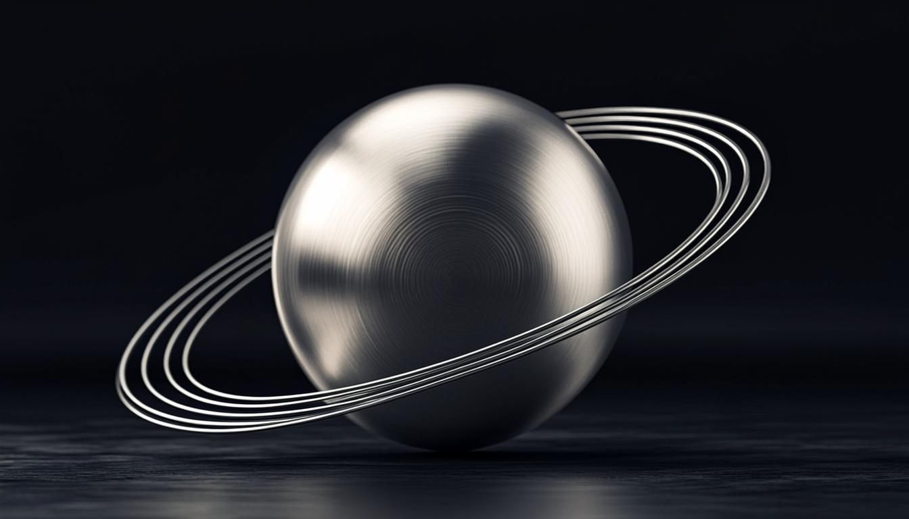

<div align="center">


# OE BUSINESS

**THE NEXT FORM** — Sitio institucional oficial

*El futuro no se espera. Se construye.*

[](https://nextjs.org)
[](https://www.typescriptlang.org)
[](https://tailwindcss.com)
[](https://r3f.docs.pmnd.rs)
[](https://www.prisma.io)



</div>

---

## Sobre el proyecto

**OE BUSINESS** es una firma independiente fundada por **Oscar y Eduardo**. Este repositorio contiene su experiencia digital oficial: una página institucional de un solo recorrido, concebida como una **pieza editorial cinematográfica** — no como una plantilla.

La dirección de arte combina un estudio tecnológico de alto nivel, arquitectura futurista y tipografía suiza, sobre una paleta monocromática de negros obsidiana, titanio pulido y un único acento azul hielo. Cada sección está construida para comunicar cinco sensaciones: **exclusividad, innovación, confianza, ambición y evolución**.

> *"Las grandes ideas comienzan con una forma diferente de mirar."*

---

## Características

### Experiencia

- **Ritual de entrada** — precarga cinematográfica con monograma, contador de precisión `000 → 100` y salida en telón dividido (una vez por sesión).
- **Escultura 3D de titanio** — objeto orbital abstracto en React Three Fiber con materiales metálicos pulidos, parallax con el cursor y partículas de polvo de titanio.
- **Scroll cinematográfico** — inercia suave con Lenis, anclas con movimientos de cámara largos y numerología fantasma monumental por capítulo.
- **Manifiesto secuencial** — coreografía tipográfica ligada al scroll: *No seguimos el futuro. Lo imaginamos. Lo cuestionamos. Lo construimos.*
- **Cursor de estudio** — punto + anillo con retardo que se expande sobre elementos interactivos (solo punteros finos).
- **Bilingüe ES / EN** — conmutación instantánea de todo el contenido, persistencia en `localStorage` y sincronización de `lang` en el documento.

### Ingeniería

- **Recepción real de contacto** — API `POST /api/contact` con validación Zod, honeypot anti-spam y persistencia en base de datos vía Prisma.
- **Degradación elegante** — alternativas estáticas cuando WebGL no está disponible; `prefers-reduced-motion` respetado en toda la experiencia.
- **Rendimiento** — 3D cargado de forma diferida, fuentes optimizadas con `next/font`, sin desbordamiento horizontal en móvil.
- **SEO completo** — metadatos, Open Graph, Twitter Cards, favicon original y jerarquía semántica correcta.
- **Accesibilidad** — navegación por teclado, skip-link, roles ARIA y contraste verificado.

---

## Stack tecnológico

| Capa | Tecnología |
| --- | --- |
| Framework | Next.js 16 (App Router) · TypeScript 5 |
| Interfaz | Tailwind CSS 4 · shadcn/ui · Lucide Icons |
| 3D y movimiento | React Three Fiber · Drei · Framer Motion · Lenis |
| Datos | Prisma ORM · SQLite |
| Validación | Zod |
| Calidad | ESLint · verificación end-to-end en navegador |

---

## Estructura del proyecto

```
├── prisma/
│   └── schema.prisma          # Modelo ContactMessage (persistencia de contacto)
├── public/
│   ├── oe-logo.svg            # Monograma OE (orbital + barras estructurales)
│   ├── og.png                 # Imagen Open Graph
│   └── robots.txt
├── src/
│   ├── app/
│   │   ├── api/contact/       # Endpoint de recepción de mensajes
│   │   ├── icon.svg           # Favicon original de la marca
│   │   ├── layout.tsx         # Metadatos SEO + tipografías
│   │   └── page.tsx           # La experiencia completa (una sola ruta)
│   ├── components/
│   │   ├── oe/                # 25 componentes de la experiencia
│   │   │   ├── intro-gate.tsx     # Ritual de entrada
│   │   │   ├── orbital-object.tsx # Escultura 3D de titanio
│   │   │   ├── hero.tsx           # Portada cinematográfica
│   │   │   ├── manifesto.tsx      # Secuencia de manifiesto
│   │   │   └── ...
│   │   └── ui/                # Primitivas shadcn/ui
│   └── lib/
│       ├── db.ts              # Cliente Prisma
│       └── i18n/
│           └── dictionary.ts  # Espejo completo ES / EN
└── db/                        # Base de datos SQLite (no versionada)
```

---

## Puesta en marcha

### Requisitos

- **Bun** 1.x (recomendado) o Node.js 20+

### Instalación

```bash
# 1. Clonar el repositorio
git clone https://github.com/rafaelg0315g-lab/oe-bussines.git
cd oe-bussines

# 2. Instalar dependencias
bun install

# 3. Configurar variables de entorno
cp .env.example .env   # (o crear .env manualmente — ver tabla siguiente)

# 4. Sincronizar la base de datos
bun run db:push
```

### Desarrollo

```bash
bun run dev        # Servidor de desarrollo en el puerto 3000
bun run lint       # Verificación de calidad de código
bun run build      # Compilación de producción
bun run start      # Servidor de producción
```

### Variables de entorno

| Variable | Descripción | Ejemplo |
| --- | --- | --- |
| `DATABASE_URL` | Ruta de la base de datos SQLite | `file:./db/custom.db` |
| `NEXT_PUBLIC_SITE_URL` | Dominio público del sitio (pendiente de registrar) | `https://tu-dominio.com` |
| `NEXT_PUBLIC_CONTACT_EMAIL` | Correo de negocio mostrado en contacto | `contact@tu-dominio.com` |

---

## Recorrido del sitio

| Cap. | Sección | Contenido |
| --- | --- | --- |
| — | Hero | *EL FUTURO NO SE ESPERA. Se construye.* — portada con escultura 3D |
| — | Transición | *"Las grandes ideas comienzan con una forma diferente de mirar."* |
| 01 | Identidad | *"Más que una empresa, una visión."* — quiénes somos |
| 02 | Filosofía | Visión · Innovación · Evolución — tres principios en movimiento |
| — | Visión | *"Construir hoy lo que definirá el mañana."* — escena monumental |
| 03 | Fundadores | Oscar y Eduardo — dos perspectivas, una visión compartida |
| — | Manifiesto | Secuencia tipográfica ligada al scroll |
| 04 | Contacto | Conversación directa: WhatsApp y formulario |
| — | Footer | Cierre editorial con wordmark metálico monumental |

---

## Filosofía de diseño

```
01 — VISIÓN        Miramos más allá del presente para imaginar nuevas posibilidades.
02 — INNOVACIÓN    Cuestionamos lo establecido y exploramos nuevas formas de pensar.
03 — EVOLUCIÓN     Cada idea, experiencia y desafío es una oportunidad para avanzar.
```

**Sistema visual** — negros obsidiana `#070809` · grafito `#1A1D21` · plata titanio `#B9C0C9` · blanco hielo `#F4F6F8` · un único acento azul `#8BAEFF`. Tipografía: Space Grotesk (display) · Inter (texto) · IBM Plex Mono (detalles técnicos).

---

## Contacto

<div align="center">

**OE BUSINESS** — *Una visión compartida. Una mentalidad innovadora.*

[](https://wa.me/573247078735)

**WhatsApp:** [+57 324 707 8735](https://wa.me/573247078735)

*Toda gran visión comienza con una conversación.*

</div>

---

<div align="center">


**© OE BUSINESS** — Todos los derechos reservados.

*El futuro no se espera. Se construye.*

</div>
